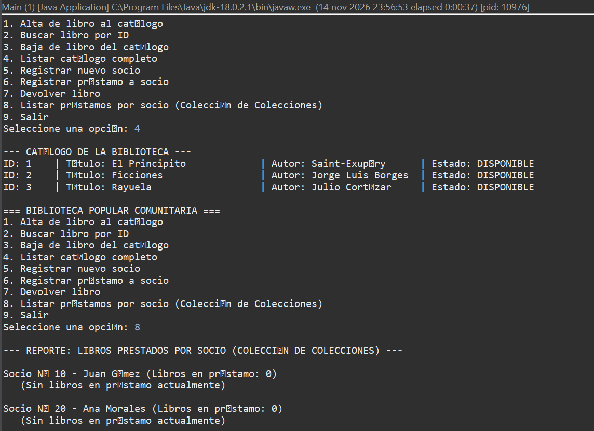

# Biblioteca Barrial

Sistema de gestión de préstamos para una biblioteca barrial.

**Integrantes:** *Gonzalo Rodriguez (gonzarodcab), Dario Roldan (Darioroldan)*

**Repositorio:** https://github.com/Darioroldan/Grupo11-BibliotecaBarrial-digital

**Tablero Kanban:** [enlace a Trello](https://trello.com/invite/b/6aef53fea4e519e131faade4/ATTI4747d3aaa0ef90b058776374c83ea039A13C4179/grupo11-bibliotecabarrial-digital)

## Descripción del negocio
La Biblioteca Barrial es un espacio comunitario que presta libros a los vecinos del barrio. Sus clientes son los socios, que retiran libros por un tiempo determinado y los devuelven. La biblioteca necesita llevar el catálogo de libros y saber qué tiene prestado cada socio.

## Problema que resuelve
Hoy el catálogo y los préstamos se anotan a mano, por lo que es difícil saber qué libros hay, cuáles están prestados y qué tiene cada socio. El programa permite agregar, quitar, buscar y listar libros, y registrar los libros que lleva cada socio.

## Tema elegido
Clase 6: Colecciones y Listas.

Lo elegimos porque encaja con lo que necesita la biblioteca:
- El catálogo se maneja con una lista de objetos `Libro`.
- Cada `Socio` tiene su propia lista de libros prestados. Así tenemos una colección de colecciones, como pide el tema: la lista de socios, y dentro de cada socio, una lista de libros.

## Tecnologías
- Java (jdk-18.0.2.1)
- IDE: Eclipse 
- GitHub: repositorio del proyecto
- Trello: tablero Kanban

## Cómo ejecutar el proyecto 
1. Clonar el repositorio: `git clone https://github.com/Darioroldan/Grupo11-BibliotecaBarrial-digital.git` 
2. Abrir Eclipse e importar el proyecto (*File → Import → Existing Projects into Workspace*). 
3. Ejecutar la clase `Main` (paquete `com.biblioteca`): clic derecho → *Run As → Java Application*. Se abre un menú por consola.
   
## Funcionalidades 
- Agregar libros al catálogo, con validación de ID único. 
- Eliminar libros (no permite borrar uno que está prestado). 
- Buscar un libro por ID y listar el catálogo completo. 
- Registrar socios, con validación de número de socio único. 
- Prestar un libro a un socio y registrar su devolución. 
- Reporte de los libros prestados por cada socio.

## Capturas de pantalla

## Pruebas realizadas

Se probó el programa ejecutando la clase `Main` en Eclipse: listado del catálogo, reporte de préstamos por socio, alta de socio, préstamo y devolución de libros. El detalle de cada caso, con el resultado esperado y el obtenido, está en la carpeta [/pruebas](pruebas/).

## Conclusiones

**Qué aprendimos:** Aprendimos a trabajar en un proyecto de programación de principio a fin: pasar de la idea al análisis, el diseño, el desarrollo y las pruebas, y organizar todo en etapas con un tablero en Trello y un repositorio en GitHub.

**Qué dificultades tuvimos:** Fuimos solo dos integrantes en el grupo. Nos llevó tiempo familiarizarnos con Trello y GitHub, y tuvimos un problema con la codificación de los acentos en la consola de Eclipse, que resolvimos cambiando su configuración.

**Qué mejoraríamos:** Mejoraríamos el diseño de la consola para que el menú y los mensajes sean más claros y fáciles de usar para el encargado de la biblioteca.
