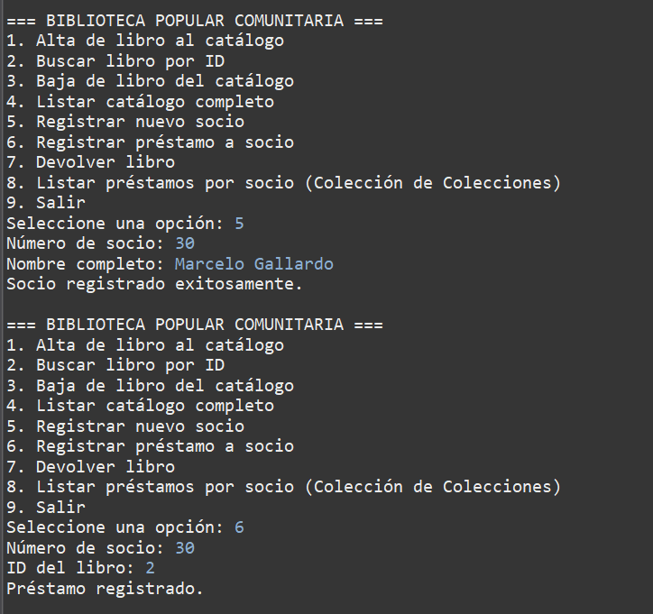
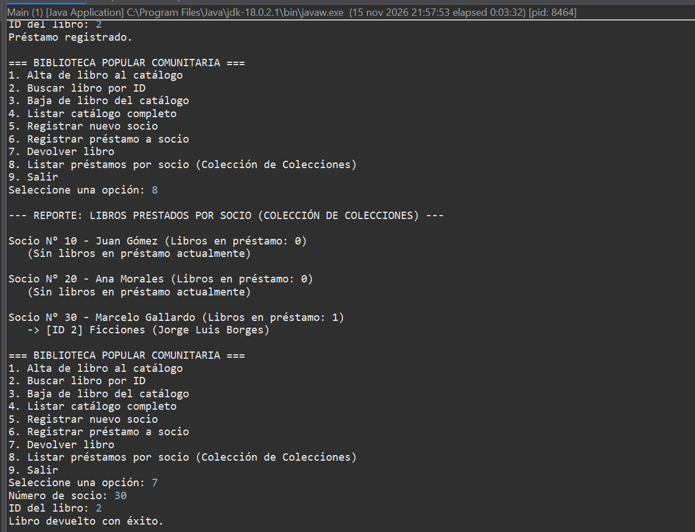

# Plan de pruebas

Datos precargados: libros con ID 1, 2 y 3; socios con número 10 y 20.
Las pruebas se hicieron ejecutando la clase `Main` en Eclipse.

| N° | Prueba | Pasos | Resultado esperado | Resultado obtenido |
|---|---|---|---|---|
| 1 | Listar el catálogo | Opción 4 | Muestra los 3 libros precargados, todos DISPONIBLE | Coincide con lo esperado |
| 2 | Reporte de préstamos por socio (sin préstamos) | Opción 8 | Cada socio figura con 0 libros en préstamo | Coincide con lo esperado |
| 3 | Registrar un socio nuevo y prestarle un libro | Opciones 5 y 6 | "Socio registrado exitosamente." y "Préstamo registrado." | Coincide con lo esperado | 
| 4 | Reporte de préstamos y devolución | Opciones 8 y 7 | El socio figura con 1 libro; luego "Libro devuelto con éxito." | Coincide con lo esperado |

## Observaciones

- En la consola de Eclipse los acentos y la ñ se ven como "�". Es un tema de codificación de la consola, no afecta el funcionamiento del programa.
- 
-15/11 Se soluciona el error "�" en la configuración de Eclipse.
